# Wish Hounds Press

**Live site:** [https://tabithapotts.github.io/wish-hounds-press/](https://tabithapotts.github.io/wish-hounds-press/)

Wish Hounds Press is the website for a small publishing imprint run by an author. It publishes dark literary short fiction and is named after the Wish, or Wisht, Hounds of Devon: a pack of spectral hounds that kept their kennel in Wistman's Wood and hunted lone travellers and the spirits of unbaptised children.

The site presents the imprint's first title, *A Book of Short Stories*, lets readers sample every story, and sends them to the retailers where they can buy it.

<a href="docs/screenshots/index-desktop.png">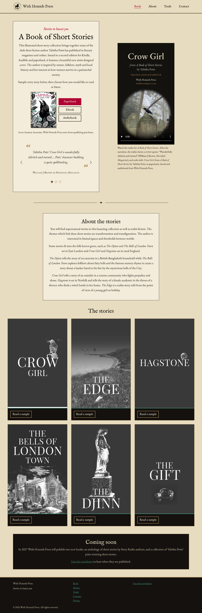</a>

## At a glance

| | |
| :---- | :---- |
| **Pages** | Book (home), About, Trade, Contact, plus a thank-you page for the contact form |
| **Built with** | HTML, CSS, Bootstrap 5.3.9 and one short JavaScript file |
| **Forms** | Web3Forms, with no JavaScript |
| **Hosted on** | GitHub Pages |
| **Best features** | Story samples with audio, and the Crow Girl trailer |

## Table of contents

1. [Purpose](#purpose)
2. [Who it is for](#who-it-is-for)
3. [Features and user benefits](#features-and-user-benefits)
4. [Screenshots](#screenshots)
5. [Design](#design)
6. [Technologies used](#technologies-used)
7. [Testing](#testing)
8. [Bugs and errors](#bugs-and-errors)
9. [Deployment](#deployment)
10. [Credits and attribution](#credits-and-attribution)
11. [Declaration of AI use](#declaration-of-ai-use)
12. [Planned future updates](#planned-future-updates)

## Purpose

The site has three aims:

1. **Sell books** by sending readers to retailers.
2. **Build a mailing list** through a newsletter sign-up.
3. **Present the imprint** to bookshops, and to authors who may want to submit.

The structure allows new titles to be added later, starting with the two books planned for 2027: an anthology of short stories by Story Radio authors and a collection of Tabitha Potts' prize-winning stories.

## Who it is for

| Visitor | What they need | Where they find it |
| :---- | :---- | :---- |
| Readers | Learn about the book, sample each story, find where to buy it in print, ebook or audiobook | Book page |
| Bookshops | Trade information and contact details | Trade page, then Contact page |
| Authors | Whether the imprint is open to submissions | Trade page |
| Reviewers | Information about the book and a way to ask for a review copy | Book page, then Trade or Contact page |

## Features and user benefits

### On every page

- **Navigation bar and footer:** the same on every page, so visitors can move around from anywhere. On phones the links collapse into a menu.
- **Newsletter link:** a "Join the newsletter" link in every footer, so visitors can sign up from anywhere.
- **Accessibility and speed:** semantic HTML, alt text on meaningful images and lazy-loaded images.

### Book page

| Feature | What it does | Why it helps |
| :---- | :---- | :---- |
| Hero section | Logo, blurb, cover and buy buttons for paperback, ebook and audiobook, with an affiliate link disclosure | Readers can go straight to a retailer |
| Reviews slider | Three reviews, changed only by the arrows or dots | Nothing moves on its own, which is better for accessibility |
| Crow Girl trailer | A portrait video with my narration, on-screen words and a poster image; it only downloads when the visitor presses play | Gives a feel for the book and the audiobook without slowing the page |
| About the stories | An introduction to the themes of the collection | Sets the scene before the samples |
| Story samples | One card per story. "Read a sample" opens a pop-up with the story's opening and an audio clip of me reading it | Readers can sample the book and audiobook without leaving the page. The text doubles as a transcript of the audio |
| Coming soon | A panel about the two books planned for 2027, with a link to the newsletter | Encourages readers to sign up |

I think the samples and the trailer are the best features of the site.

### About page

- **The imprint's story:** why I started Wish Hounds Press.
- **The Devon legend:** the story behind the name, with a link to read more.
- **Author bio:** a short biography, including my awards and shortlistings.
- **Newsletter sign-up:** each sign-up arrives by email through Web3Forms, and I add it to the mailing list by hand.

### Trade page

- **Trade information** for bookshops and libraries: ISBN, format, pages, price and publication date, with a link to the contact form for trade terms and review copies.
- **Submissions note:** tells authors that submissions are currently closed.

### Contact page

- **Contact form:** the browser checks the required fields and the email address before sending. Afterwards the visitor sees a thank-you page, so they know the message went through.
- **"Who are you?" dropdown:** reader, bookshop or library, press or reviewer, or other, so I can see at a glance what each message is about.
- **Privacy note:** explains how visitors' details are used.

Trade and contact information started out on one page, but it looked too busy, so I split it into two.

## Screenshots

Full-page screenshots on desktop (1280 pixels wide) and mobile (390 pixels wide). Click any image to open it at full size.

| Page | Desktop | Mobile |
| :---- | :---- | :---- |
| Book | <a href="docs/screenshots/index-desktop.png"></a> | <a href="docs/screenshots/index-mobile.png"></a> |
| About | <a href="docs/screenshots/about-desktop.png">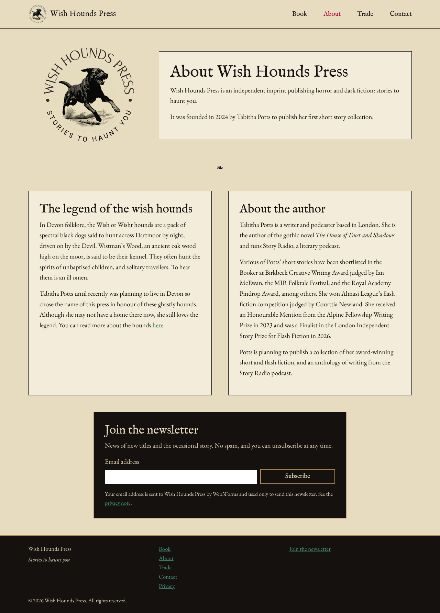</a> | <a href="docs/screenshots/about-mobile.png">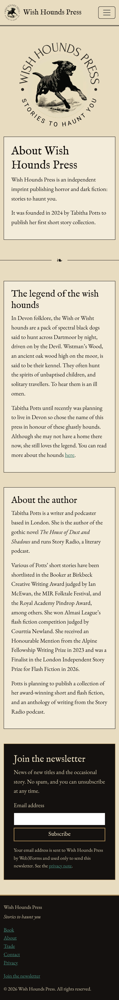</a> |
| Trade | <a href="docs/screenshots/trade-desktop.png">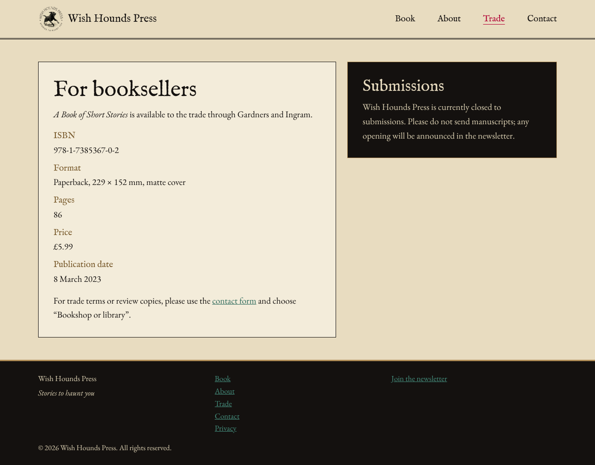</a> | <a href="docs/screenshots/trade-mobile.png">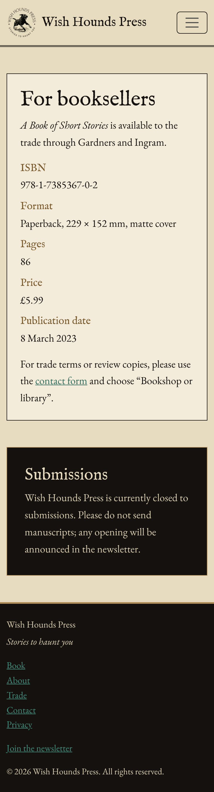</a> |
| Contact | <a href="docs/screenshots/contact-desktop.png">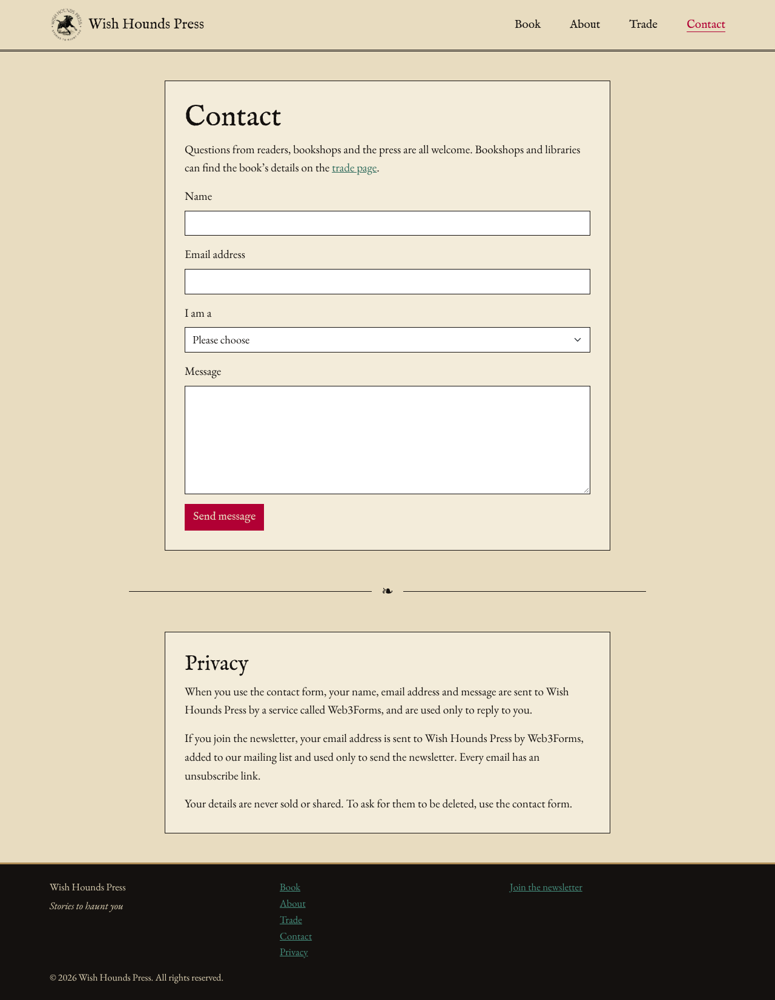</a> | <a href="docs/screenshots/contact-mobile.png">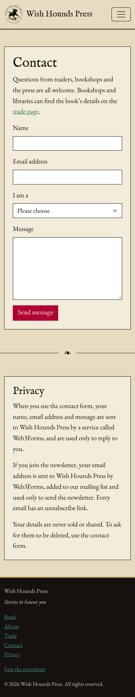</a> |
| Thank you | <a href="docs/screenshots/thank-you-desktop.png">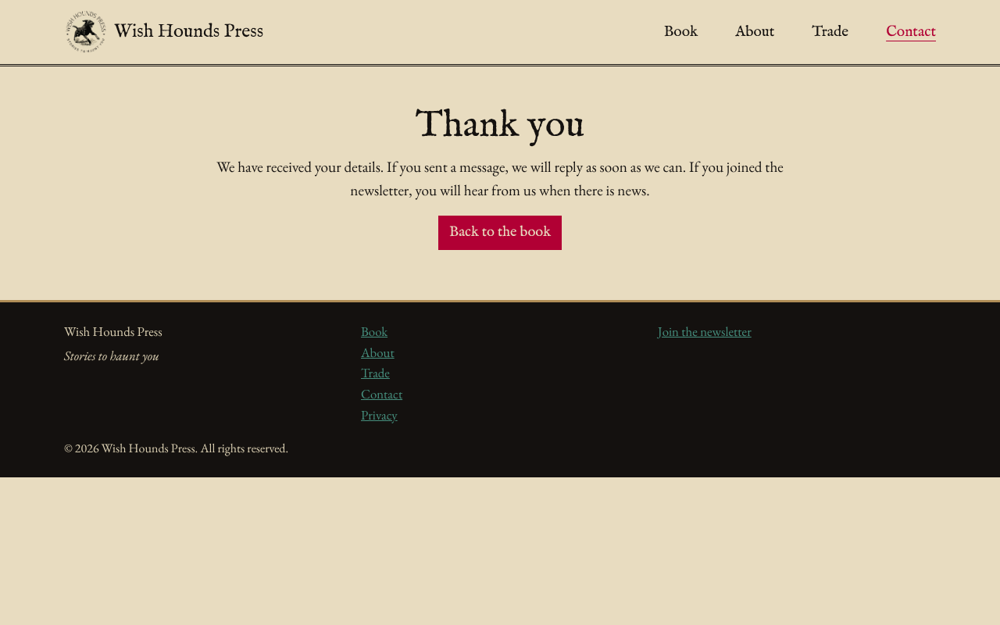</a> | <a href="docs/screenshots/thank-you-mobile.png">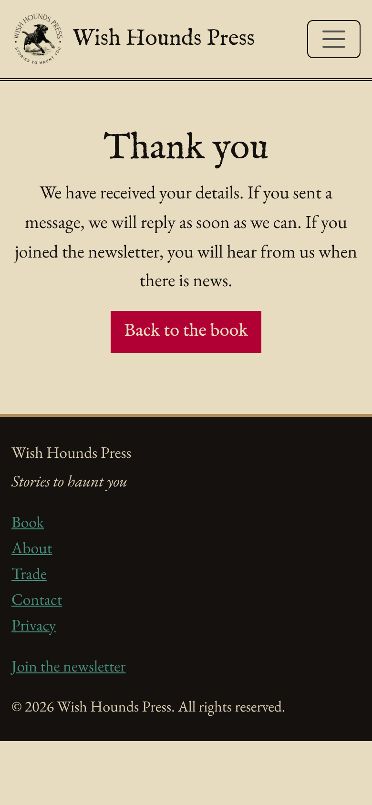</a> |

## Design

The look is dark but stylish, like an old book: a parchment page, near-black story cards and black-line engraving-style artwork. Woodcuts and an "old book" feel are common on folk horror websites, so the style tells visitors straight away what kind of fiction the imprint publishes.

### Fonts

Both come from Google Fonts and are held as CSS variables (`--font-heading` and `--font-body`).

- **IM Fell English** for headings, the navigation, buttons and drop caps. It looks like an old printed book and adds atmosphere.
- **EB Garamond** for body text, because it is easier to read in longer passages.

### Colours

All colours are held as CSS variables, so they stay consistent across pages. The cover red and teal were sampled from the book cover.

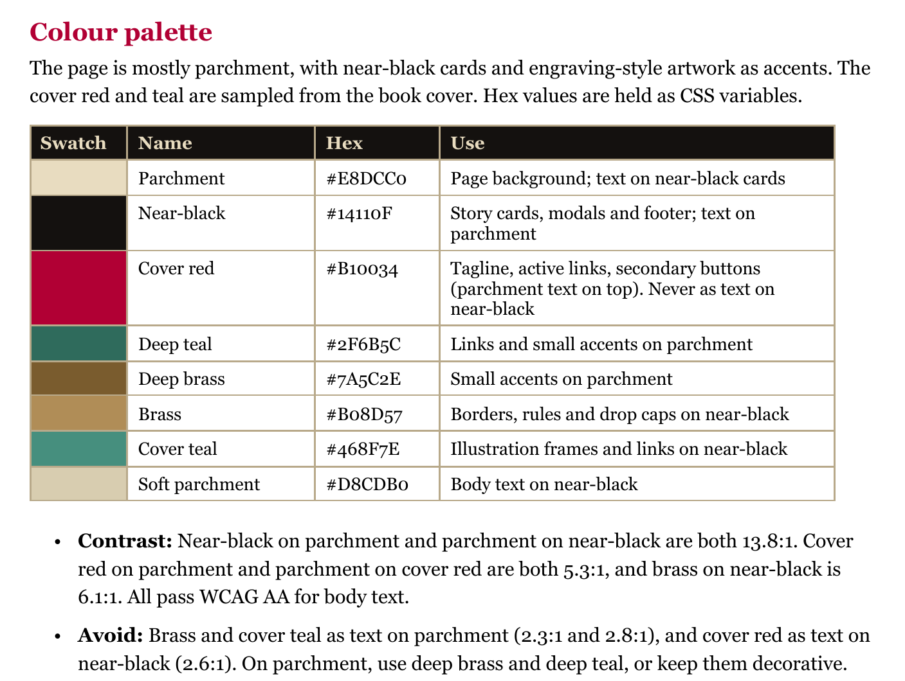

| Name | Hex | Use |
| :---- | :---- | :---- |
| Parchment | `#E8DCC0` | Page background; text on near-black cards |
| Near-black | `#14110F` | Story cards, pop-ups and footer; text on parchment |
| Cover red | `#B10034` | Tagline, active links, secondary buttons |
| Deep teal | `#2F6B5C` | Links and small accents on parchment |
| Deep brass | `#7A5C2E` | Small accents on parchment |
| Brass | `#B08D57` | Borders, rules and drop caps on near-black |
| Cover teal | `#468F7E` | Illustration frames and links on near-black |
| Soft parchment | `#D8CDB0` | Body text on near-black |
| Light parchment | `#F3ECDA` | Background of the body text panels |

**Contrast:** near-black on parchment, and parchment on near-black, both reach 13.8:1, which passes WCAG AA. Cover red is never used as text on near-black, and brass and cover teal are never used as text on parchment, because those pairings fail.

### Wireframes

I planned the Book page mobile first, with wireframes for mobile, tablet and desktop.

<details>
<summary>Show the wireframes</summary>

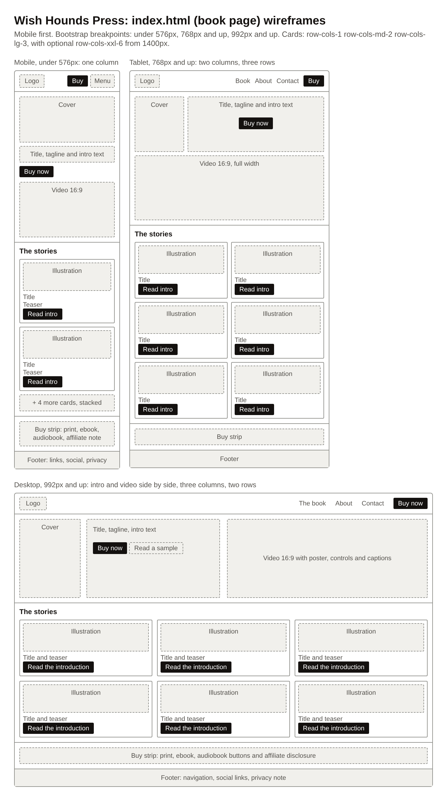

</details>

The finished page changed in three places as I built it:

- the trailer became a portrait video rather than 16:9;
- the buy buttons moved into the hero rather than a separate buy strip;
- a reviews slider was added.

### Layout decisions

| Decision | Reason |
| :---- | :---- |
| Centred text in the hero and "About the stories", with the story text in the pop-ups left-aligned | Long centred passages are harder to read |
| Body text in pale parchment panels (`.panel-light`) with a thin near-black border | My teacher said the text looked "floaty". The class goes on a div inside each Bootstrap column, not on the column itself, so the gaps between columns stay intact |
| A divider made of a plain line with a printer's flower (❧), using flexbox and `::before` and `::after` | Simple, and I can explain every line of it |
| Navigation links on the right, collapsing into a menu on phones | An earlier version used container query units (`cqw`) to line the links up with the Trade page, but I simplified it because the calculation was too complex to explain |
| Reviews slider that never moves on its own, with large brass quotation marks, Bootstrap's `carousel-dark` arrows and brass dots | Accessibility, and to match the old-book style |

## Technologies used

- **HTML5** for the structure of each page.
- **CSS3** for the design, with CSS variables for colours and fonts.
- **[Bootstrap 5.3.9](https://getbootstrap.com/)** for the grid, navigation, reviews slider and story pop-ups.
- **JavaScript:** one short file, `assets/js/story-audio.js`, which pauses the audio when a story pop-up closes. Without it, the reading would carry on playing after the pop-up has gone.
- **[Web3Forms](https://web3forms.com/)** for the contact form and newsletter sign-up.
- **Git, GitHub and GitHub Projects** for version control and planning.
- **VS Code** for writing the code.

## Testing

### Summary

| Test | Result |
| :---- | :---- |
| HTML (W3C) | All pages pass with no errors or warnings |
| CSS (W3C Jigsaw) | No errors |
| Lighthouse Accessibility | 100 on every page |
| Lighthouse Best Practices | 100 on every page |
| Lighthouse SEO | 100, except the thank-you page (63, on purpose; see below) |
| Lighthouse Performance | 92 to 99 on mobile, 99 to 100 on desktop |

### HTML validation

Each live page was checked with the [W3C Markup Validation Service](https://validator.w3.org/nu/) on 22 November 2026.

| Page | Result | Screenshot |
| :---- | :---- | :---- |
| Book, before the fix | 7 errors (see [Bugs and errors](#bugs-and-errors)) | [html-index-before.png](docs/testing/validation/html-index-before.png) |
| Book, after the fix | No errors or warnings | [html-index-after.png](docs/testing/validation/html-index-after.png) |
| About | No errors or warnings | [html-about.png](docs/testing/validation/html-about.png) |
| Trade | No errors or warnings | [html-trade.png](docs/testing/validation/html-trade.png) |
| Contact | No errors or warnings | [html-contact.png](docs/testing/validation/html-contact.png) |
| Thank you | No errors or warnings | [html-thank-you.png](docs/testing/validation/html-thank-you.png) |

### CSS validation

`assets/css/styles.css` was checked with the [W3C CSS Validation Service](https://jigsaw.w3.org/css-validator/): no errors found.

The validator also lists 14 warnings saying "CSS variables are currently not statically checked". This is its standard message for any stylesheet that uses CSS variables, not a fault.

<details>
<summary>Show the CSS validation screenshot</summary>

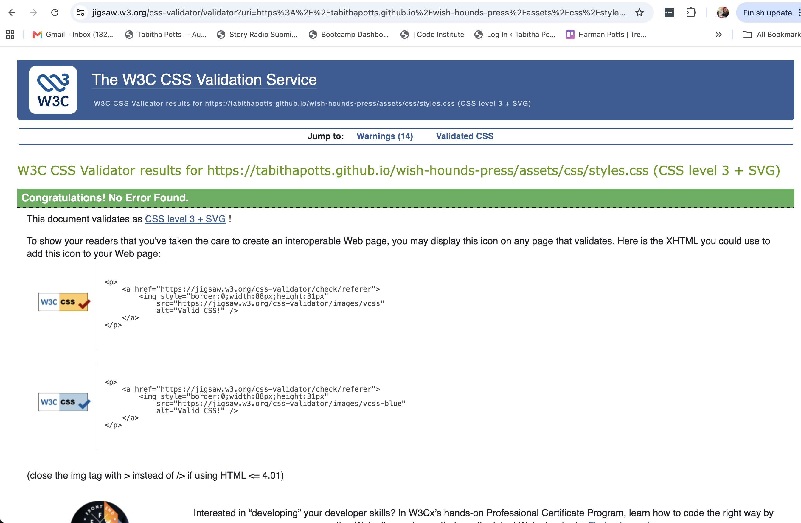

</details>

### Lighthouse

I ran Lighthouse on every live page with Google's [PageSpeed Insights](https://pagespeed.web.dev/) on 22 November 2026 (Lighthouse 13.6.0).

| Page | Performance (mobile / desktop) | Accessibility | Best Practices | SEO |
| :---- | :---- | :---- | :---- | :---- |
| Book | 96 / 99 | 100 | 100 | 100 |
| About | 92 / 99 | 100 | 100 | 100 |
| Trade | 98 / 100 | 100 | 100 | 100 |
| Contact | 98 / 100 | 100 | 100 | 100 |
| Thank you | 99 / 100 | 100 | 100 | 63 |

- **Why mobile performance is lower:** the mobile test simulates a mid-range phone on a slow 4G connection.
- **Why the thank-you page scores 63 for SEO:** it has `<meta name="robots" content="noindex">` on purpose, so search engines don't list it. Visitors should only reach it after sending a message.
- **How the About page went from 91 to 100 for SEO:** a link used the text "here". Link text should make sense on its own, because screen-reader users often move from link to link. I changed it to "Read more about the Wisht Hounds of Dartmoor".

Screenshots are in [`docs/testing/lighthouse/`](docs/testing/lighthouse/), named `pagespeed-<page>-mobile.png` and `pagespeed-<page>-desktop.png`. That folder also holds full reports from an earlier Lighthouse run; open the `.html` files in a browser to view them.

<details>
<summary>Show the Book page Lighthouse screenshots</summary>

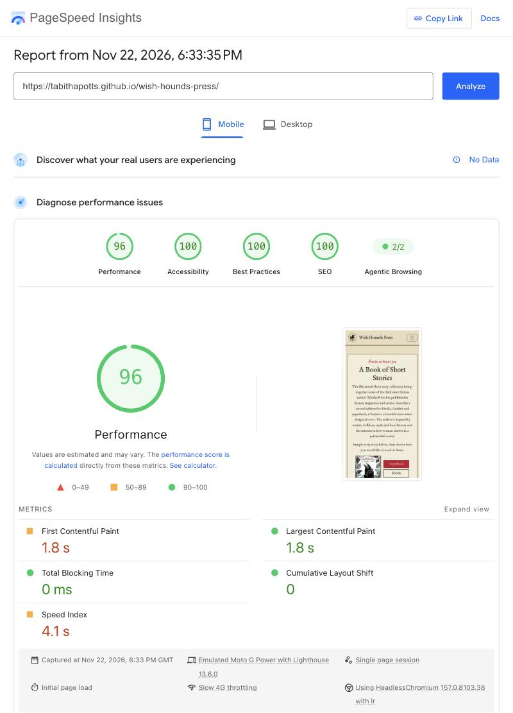
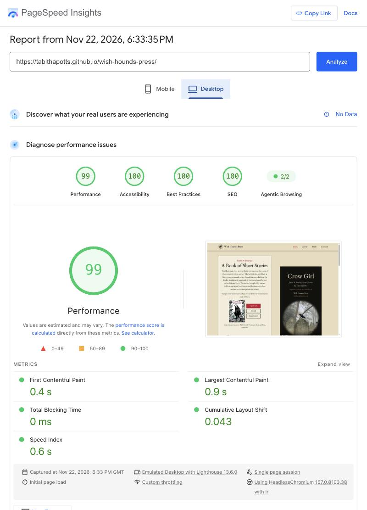

</details>

### Manual testing

<!-- TO DO before the presentation: test each row on the live site, then replace "To test" with "Pass" or describe what went wrong. -->

| Feature | What I did | Expected result | Result |
| :---- | :---- | :---- | :---- |
| Navigation | Clicked every link in the navigation bar on each page | Each link opens the right page | To test |
| Mobile menu | Opened the site at phone width and tapped the menu button | The links appear and work | To test |
| Buy buttons | Clicked the paperback, ebook and audiobook buttons | Each opens the right retailer | To test |
| Story pop-ups | Opened each of the six "Read a sample" pop-ups | The right story and audio appear | To test |
| Audio stops on close | Played a sample, then closed the pop-up | The audio stops | To test |
| Trailer | Pressed play on the Crow Girl trailer | The video plays with on-screen words | To test |
| Reviews slider | Clicked the arrows and dots | The reviews change; they never move on their own | To test |
| Contact form, empty | Pressed Send with the required fields empty | The browser asks me to fill them in | To test |
| Contact form, sent | Sent a real message on the live site | The thank-you page appears and the email arrives | To test |
| Newsletter sign-up | Signed up on the live site | The sign-up email arrives | To test |
| Responsive layout | Checked every page at desktop, tablet and phone widths | Nothing overlaps, is cut off or needs sideways scrolling | To test |

## Bugs and errors

All of these have been fixed. No known bugs remain.

| Bug | Cause | Fix |
| :---- | :---- | :---- |
| 7 W3C errors on the Book page | A plain `div` can't have `aria-label` or `aria-labelledby` without a `role`. Bootstrap adds `role="dialog"` to a pop-up with JavaScript when it opens, but the validator only reads the HTML | Added `role="region"` to the reviews carousel and `role="dialog"` to each pop-up |
| Two `<h1>` headings on the Book page | Adding the blurb created a second `<h1>`. A page should have one, as screen readers use it as the main title | Removed the second one |
| `<figcaption>` rejected by the validator | It was inside `<blockquote>`, but must sit directly inside a `<figure>` | Wrapped each review in a `<figure>` and moved the `<figcaption>` after the `<blockquote>` |
| Trailer cropped to a narrow strip | A landscape (16:9) frame cut off the portrait video | Changed the frame to 9:16 with a maximum height |
| Trailer too large (14.6 MB) | Original video size | Resized to 720 x 1280. The remade trailer is 4.7 MB |
| About page logo squashed on tablets | Between 768px and 991px the logo column was only about 240px wide, so the lettering ran into the heading | Moved the side-by-side layout from Bootstrap's `md` breakpoint (768px) to `lg` (992px) |

## Deployment

The site is deployed with GitHub Pages from the `main` branch.

1. Push the latest code to the `main` branch of the GitHub repository.
2. In the repository, open **Settings**, then **Pages**.
3. Under **Build and deployment**, set the source to **Deploy from a branch**, choose `main` and the `/ (root)` folder, then save.
4. Wait a minute or two, then open the live link at the top of this file.

After deploying, I checked that the live site matches the version running locally. The site will later move to the imprint's own domain, wishhoundspress.com.

**To run it locally:** clone the repository and open `index.html` in a browser.

```
git clone https://github.com/tabithapotts/wish-hounds-press.git
```

## Credits and attribution

### Code and services

- [Bootstrap 5.3.9](https://getbootstrap.com/), loaded from the jsDelivr CDN.
- [Google Fonts](https://fonts.google.com/): IM Fell English and EB Garamond.
- [Web3Forms](https://web3forms.com/) for the contact form and newsletter sign-up.

### Images

- Cover design of *A Book of Short Stories* by Sophie Harris-Greenslade.
- The story title plates are from *A Book of Short Stories*. They were either sourced from out-of-copyright images or created by me, except the Crow Girl plate, which is credited in the book as "Illustration by Amy Shepheard".

### Video and audio

- **Crow Girl trailer:** made from my own crow photographs, set in EB Garamond, with my narration. Built by Claude at my request.
- **Audio samples:** read by me, taken from the audiobook of *A Book of Short Stories* on Audible. As the audiobook is exclusive to Audible through ACX, excerpts on my own website must be verbatim and no longer than 5 minutes or 10% of the audiobook's length, whichever is longer. The samples total about 7 minutes.

### Text and reviews

- Story openings and the blurb are from *A Book of Short Stories* by Tabitha Potts.
- Reviews by William J Brown in *Horrified Magazine*, I. Rosenfeld for the British Fantasy Society, and strange.scholar on Instagram.

## Declaration of AI use

I used Claude, in the Claude desktop app, and Claude Code, in VS Code. I used them to create a prototype of the site from the brief I had already worked out, then edited it to reach the aesthetic and functionality I wanted. Due to pressure of time I was not able to build the site step by step, as I had originally planned, but I am pleased with the result and plan to use it on my own site.

### What Claude did

- Built the first version of the pages and the stylesheet from my brief, wireframes and colour palette.
- Converted the logo and story title plates to WebP, and copied the opening of each story from the print PDF into the pop-ups.
- Drafted the first versions of the legend paragraph, the author bio and the privacy note, which I then checked.
- Wrote the audio player code. Edited the original trailer, and later built the new trailer from my photographs.
- Found and fixed HTML validator errors, and ran Lighthouse and validation checks.
- Replaced the contact form script with a version that needs no JavaScript, at my teacher's request.
- Copied the planning issues onto my GitHub project board from my User Journey notes, and wrote about three-quarters of the commit messages.
- Suggested a clearer layout for this README.

### What I decided and did myself

- Wrote the brief and planned the site: its audiences, pages, colours and wireframes.
- Wrote the blurb, story descriptions and awards, and chose the reviews.
- Narrated the audiobook and the trailer, and cut the audio samples from my audiobook myself in Descript.
- Chose the house style: curly quotes, italic titles and "Potts'".
- Made the design decisions in [Layout decisions](#layout-decisions), including the text panels after my teacher's feedback, the printer's flower divider, the simpler navigation and a reviews slider that doesn't move on its own.
- Split trade and contact information into two pages because one page looked too busy, and chose a portrait frame for the trailer.

### Reflections

I was an early adopter of AI as I am very interested in technology, and have become very comfortable using it for routine tasks in spite of my reservations about it. Perhaps I have become too comfortable, as it has made site building so easy that I tend to focus on the aspects of it that interest me the most, such as look and feel, and am more reluctant to focus on the aspects I find challenging. AI has improved the speed at which I work and compensates in some of the areas where my skills are weaker. However, I will continue to work on improving those areas independently.

## Planned future updates

- A page for the Story Radio anthology, the imprint's second title.
- A submission form with file attachments (a paid Web3Forms feature).
- Correcting the lettering on the imprint logo.
- Search and filter for the catalogue.
- A blog and an events section.
- Direct paperback sales through a hosted checkout, as a later phase.
